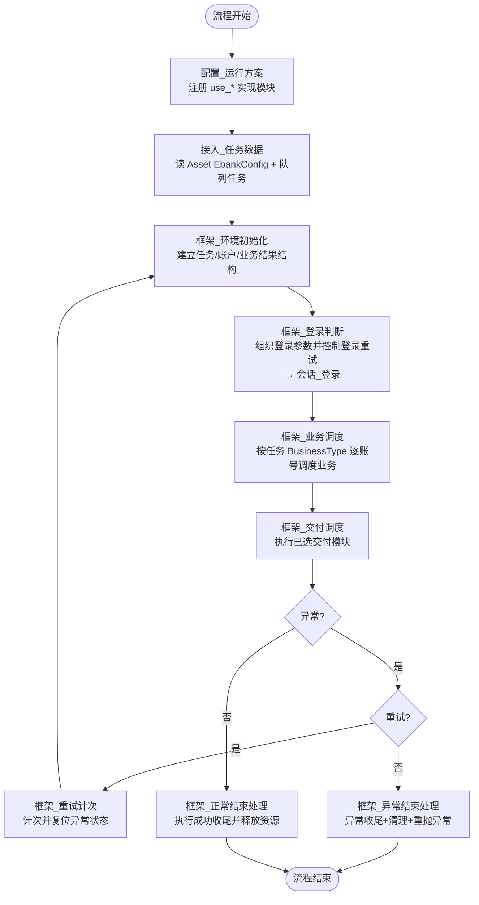

# 中国银行企业网银自动化流程 需求流程说明文档

- 项目：APA中国银行测试1（单流程项目 `main.prjp`）
- 文档版本：v1.0（2026-09-21，随需求确认与流程开发完成一次性编写）
- 维护约定：本文档随流程变更同步更新；修改流程块、元素、契约或运行方案后须同步修订对应章节。

---

## 1. 流程目标与业务范围

本流程基于企业级网银自动化框架（模板来自农行企业网银，适配中国银行），自动完成中国银行企业网银（iGTB Net）的登录、业务查询下载、安全退出与收尾处理。

业务范围（按 `BusinessType` 编号注册于 `配置_运行方案.py`）：

| 编号 | 业务 | 流程块 | 说明 |
|---|---|---|---|
| 1 | 流水查询和下载 | `业务_流水查询和下载` | 按日期区间查询交易流水，下载 xls 文件，逐笔计数并校验文件内账号 |
| 2 | 余额查询 | `业务_余额查询` | 进入"中行账户与回单-余额"页签，读取当前余额/可用余额 |
| 3 | 回单查询和下载 | `业务_回单查询和下载` | 按日期区间查询交易回单，整份 PDF 下载（不逐笔计数，record_count 恒为 0） |
| 4 | 对账单查询和下载 | `业务_对账单查询和下载` | 按账单月份查询明细对账单，逐条下载 PDF |

不在范围内：跨行转账、支付等写操作；短信/邮件验证码类登录方式；reCAPTCHA 等验证码处理。

## 2. 总体架构

### 2.1 运行环境

- Windows x64 执行机 + Google Chrome 浏览器
- 中国银行网银助手（BOCAssistant，注入安全控件 CryptoKitHost.BOC.x86 等）
- APA Runtime（Python 引擎），通过 `apa_runtime` 提供日志、Asset、DataQueue、WebBrowser 等能力
- 可选：新同事 CloudUSB HUB（U盾/密码输入器远程接入）、KeyBox/新同事密码输入器

### 2.2 模块划分

| 层 | 流程块 | 角色 |
|---|---|---|
| 框架编排（连线） | `配置_运行方案` → `接入_任务数据` → `框架_环境初始化` → `框架_登录判断` → `框架_业务调度` → `框架_交付调度` → 判断/重试/结束处理 | 主链路，`main.prjp` 中连线执行 |
| 公共（未连线） | `公共_数据契约`、`公共_网银能力`、`公共_网银页面操作` | Pydantic 契约、能力注册（use_*）、BFE 日历面板 JS 函数 |
| 会话（可选） | `会话_登录`、`会话_网银安全退出` | 由 `use_login` / `use_logout` 选择 |
| 业务（可选） | `业务_流水查询和下载`、`业务_余额查询`、`业务_回单查询和下载`、`业务_对账单查询和下载`、`业务_其它` | 由 `use_business(编号, 模块)` 注册 |
| 交付（可选） | `业务_流水数据转换` | 由 `use_delivery([...])` 启用（当前默认关闭） |
| 收尾（可选） | `收尾_执行结果汇总`、`收尾_密码错误处置`、`收尾_异常邮件通知` | 由 `use_finish_handlers(success=[...], failure=[...])` 配置 |
| 设备（可选） | `HUB_新同事`、`密码输入器_KeyBox`、`密码输入器_新同事` | 由 `use_hub` / `use_password_input_device` 选择 |

替换银行页面、设备厂商或交付方式时，只改 `配置_运行方案.py` 的 `use_*` 调用和对应实现文件，不改 `框架_*` 文件。

## 3. 输入契约

### 3.1 Asset 配置（平台参数 `EbankConfig`，JSON）

结构由 `公共_数据契约.AssetConfigModel` 校验：

- `Base` 段：`AppsName`（结束/重试时需关闭的进程列表）、`CertificatePasswordRetryNum`、`LoginPasswordRetryNum`、`LoginRetryNum`、`MaxRetryNum`（各类重试次数，不含首次；密码类超过上限 4 次被强制截断）、`LogLevel`、`ExScreenshotsFolderPath`、`XTSConfigPath`（启用 HUB 时必填）、`OutputFolder`（输出根目录）、`TransactionConvertEnabled`、`EnableConvertTemplate`、`TransactionTemplateFile`、`TransactionFieldMapPath`、`AllDataTableTemplateFile`（汇总模板）。
- `Set` 段：`SMTPAccount/SMTPPassword/SMTPServer/SMTPPort`（邮件）、`MySQLIp/Port/Database/Table/User/Password`（数据库）、`XTSAppKey/XTSCode`（HUB 鉴权，可由 XTS Excel 补充）。
- `User` 段：`MailReceiver`、`MailTitle`、`MailContent`、`MailCC`。

### 3.2 任务数据源（DataQueue 队列 `中国银行`，`DataQueue.PullEx` 拉取）

`SourceTaskModel` 主要字段：

- 任务标识：`id`（task_id）、`ProcessName`、`WorkerName`
- 业务：`BusinessType`（正整数列表，1=流水、2=余额、3=回单、4=对账单）、`EnableConvertTemplate`（任务级转换开关）
- U盾：`ukey_no`（U盾编号）、`ukey_ip`/`ukey_port`/`ukey_hub_port`（经 HUB 接入时三者和任务校验要求同时提供）
- 密码输入器：`keybox_no`（设备编号）、`keybox_ip`/`keybox_port`/`keybox_hub_port`、`cert_pwd_keybox_group`（证书密码槽位，启用密码输入器时必填）、`login_pwd_keybox_group`（登录密码槽位）
- 账号列表 `accounts[]`：`bank_account`、`account_name`、`open_bank_name`、`open_unit`、`keeper`、`start_date`、`end_date`（起止日期必填）

`接入_任务数据` 会核对任务设备参数与运行方案选择是否一致（启用了密码输入器/HUB 但任务缺参数，或反之，均报错终止）。

## 4. 主流程结构

`main.prjp` 变量：`ebank`（流程全局运行状态，见第 9 章）。

## 5. 各阶段详细说明

### 5.1 登录（`框架_登录判断` → `会话_登录`）

1. 设备接入：U盾/密码输入器经 HUB 时先断开残留连接、轮询等待端口可用（密码输入器最长约 5 分钟）、再连接并登记清理动作；直连本机则跳过。
2. 清理残留进程：杀 `chrome.exe` 及中行控件系进程（BOCAssistant、BOCUsertool、D4Svr_BOC、WDUIServer、InfoSuite、CryptoKitHost），轮询等待退出（最长 30 秒）+ 等待 5 秒让服务状态回收。
3. 启动网银助手（配置的 `assistant_path`），点击"一键修复"（图像识别，失败仅告警），等待安全控件初始化（约 15 秒）。
4. 启动 Chrome 打开登录页 `https://netc1.igtb.bankofchina.com/#/login-page?redirect=%2Findex`，等待元素 `块级元素
_数字证书登录`；关闭浏览器更新失败提示（`浏览器更新失败_提示窗格`/`浏览器更新失败_关闭按钮`）、页面意外关闭与恢复提示（`网银登录_页面意外关闭提示`、`网银登录_浏览器恢复提示` 等）；最大化窗口 `窗口_iGTBNet（企业网银）-GoogleChrome`。
5. 点击 `块级元素
_数字证书登录` 进入证书登录。
6. 轮询确认 Windows 安全证书选择框（桌面元素 `对话框_Windows安全_选择证书` + `窗口_Windows安全_确定`，最长 1 分 30 秒）；弹窗时机不确定，登录全链路（打开页面、点击证书登录、提交证书密码后）均会贯穿式补查；同时处理浏览器顶部证书选择框（`分组_选择证书` + `按钮_选择证书_确定`）。
7. 等待证书密码输入框 `输入控件<input>`，经密码输入器（KeyBox）按槽位输入一次证书密码并回车提交。**安全约束：一次登录尝试证书密码只输入一次，结果不明确时禁止自动重试（返回 code=4）。**
8. 等待用户名框 `输入控件<input>_用户名` 自动刷新出用户名（长轮询约 2 分钟，期间持续补查证书弹窗）；用户名始终为空则返回可重试错误（code=3）。
9. 输入登录密码前最终确认证书弹窗已点掉（否则网银以"请先关闭所有浏览器窗口"拒绝）。点击 `输入控件<input>登录密码输入框` 聚焦，密码输入器输入登录密码，点击 `按钮<button>_登录`。
10. 登录密码错误弹窗判定（`块级元素
_用户名或密码无效，请输入正确的用户名和密码！`，需元素存在且宽高>0 才算真实弹窗）→ 点击 `按钮<button>_确定2-登录密码错误提示框`。
11. 登录成功后关闭通知公告弹窗（`网银登录_通知公告弹窗`、`网银登录_通知公告关闭按钮`/`网银登录_通知公告不再提示`）。

登录结果码：0 成功；1 证书密码错误；2 登录密码错误；3 密码提交前可重试错误；4 密码已提交结果不明确（禁止重试）。`框架_登录判断` 按重试上限（`LoginRetryNum` 等）控制整段重试。

### 5.2 业务处理（`框架_业务调度`）

逐账号（`accounts[]`）、按 `BusinessType` 顺序调度，业务模块返回统一 `BusinessResultModel`（code：0 成功、2 无数据、其他失败）。账号选择统一使用通用元素 `网银_顶部账号文本` + `网银_顶部账号选中容器`（修复于 2026-09，替代硬编码账号元素）。

**流水（`业务_流水查询和下载`）**：进入"交易/回单"页 → 填写 `流水查询_开始日期输入框`/`流水查询_结束日期输入框`（BFE 日历面板 `流水查询_日期面板` 由 `公共_网银页面操作` 的 JS 函数点选）→ 点击查询 → 无数据显示 `流水查询_无匹配记录提示` 返回 code=2 → 有数据下载 EXCEL（`列表项<li>_EXCEL`、`按钮<button>_确定`），经 Chrome 另存为（`Chrome另存为_文件名输入框`、`Chrome另存为_保存按钮`、覆盖确认 `Chrome另存为_确认覆盖按钮`）落盘；文件内 A2/B2 账号与查询账号一致才返回成功。

**余额（`业务_余额查询`）**：点击 `列表项_li_余额` 进入"中行账户与回单-余额"页签，当前/可用余额直接展示，读取 `余额查询_可用余额数值` 返回，无需点击查询按钮。

**回单（`业务_回单查询和下载`）**：同"交易/回单"页按日期查询 → 无数据（`回单查询_无匹配记录提示`）返回 code=2 → 有数据勾选 `对话框_勾选全部交易` 后点击 `按钮<button>_下载回单`，等待消息中心"逐笔回单已生成"通知（`块级元素
_逐笔回单已生成，请及时查看。`）后浏览器自动下载 PDF。

**对账单（`业务_对账单查询和下载`）**：进入"银企对账"（`段落
_银企对账`）→ 明细对账单查询页（`块级元素
_明细对账单查询`）→ 填 `输入控件<input>对账单下载输入账号的输入框`，月份面板（`对账单_月份面板_年份文本`、`对账单_月份面板_上一年按钮`/`下一年按钮`、`对账单_月份面板_月份单元格_通配`）点选账单月份 → 点击 `按钮<button>_查询1` → 无数据弹窗（`对账单查询_无数据提示` + `对账单查询_无数据弹窗确定按钮`）→ 有数据逐条点击下载（`对账单下载_下载按钮_通配`）。

### 5.3 安全退出（`会话_网银安全退出`）

登录成功且全部业务/交付执行完毕后，由框架调用：点击页面右上角 `文本_退出-安全退出`，确认弹窗 `按钮<button>_确定2-安全退出`，等待退出完成；随后框架统一执行资源释放（断开 HUB 设备、关闭浏览器与相关进程）。

## 6. 收尾模块说明

由 `use_finish_handlers` 配置（当前：success=[执行结果汇总]；failure=[执行结果汇总、密码错误处置、异常邮件通知]）：

- `收尾_执行结果汇总`：正常/异常结束均生成汇总 Excel（写入账号、业务状态、产物路径、耗时等），模板取自 `Base.AllDataTableTemplateFile`。
- `收尾_密码错误处置`：仅密码错误时停用相关 U盾任务并通知运维，避免连续输错锁定（配合重试上限截断机制）。
- `收尾_异常邮件通知`：发送任务、账号和登录状态的异常通知邮件（SMTP 配置见 `Set` 段，收件人见 `User` 段）。

`框架_正常结束处理` 执行成功收尾并保证释放全部活动资源；`框架_异常结束处理` 执行异常收尾、最终清理并重抛原始异常。

## 7. 设备控制说明

- **U盾**：中行 U盾（数字证书）。直连本机时无需 HUB；经 HUB 接入时通过 `HUB_新同事`（新同事 CloudUSB）调用断电/连接/查询接口，鉴权用 XTS Excel（`Base.XTSConfigPath`）中的 `XTSAppKey`/`XTSCode`。连接前先释放残留（含强制断电恢复），成功后登记 `remember_ukey_connection` 以便结束清理。
- **密码输入器**：当前选择 `密码输入器_KeyBox`；备选 `密码输入器_新同事`（未启用）。任务提供 `keybox_no` 与 `cert_pwd_keybox_group`（登录密码槽位 `login_pwd_keybox_group` 视登录实现需要）。密码只经密码输入器受控输入，明文不落流程代码。
- **HUB 占用处理**：密码输入器被占用时轮询等待（约 3 秒×100 次）；U盾疑似被占用时重试断开 3 次，仍失败则等待 5 分钟后强制断电。

## 8. 输出产物说明

- 输出根目录：`Base.OutputFolder`，实际落盘形如 `<OutputFolder>\中国银行\<业务子目录>\<日期>`（测试验证样例：`D:\网银场景架构设计\output\中国银行\原始流水|回单|对账单\`）。
- 文件名规则：`U盾号-账户名-账号后4位-年月(YYYYMM)-业务_时间戳(YYYYMMDDHHMMSS)`，例：`535309484561-来也科技项目经理部-7721-202606-流水_20260915154401.xls`；对账单多份时业务段带序号（`对账单-1_`）。
- 文件类型：流水 xls（页面导出 EXCEL）；回单 PDF（整份）；对账单 PDF（逐条）。
- 异常截图：`Output/银行名称/日期/异常截图` 或 `Base.ExScreenshotsFolderPath` 自定义目录。
- 汇总 Excel：任务级 `summary_file`，含账号、业务状态（pending/success/no_data/failed/skipped）、错误信息、产物路径、执行耗时、记录数等（契约见 `BusinessExecutionModel`/`ExecutionLogEntryModel`）。

## 9. 全局状态变量说明

流程唯一全局变量 `GlobalVariables["ebank"]`（类型化运行状态，由 `公共_网银能力` 建立）：

- `bank_name`：当前银行名称（"中国银行"）。
- `config`：`RuntimeConfigModel`，整理后的运行配置（related_apps、retry 各级上限、database、hub、output、convert_templates、summary_templates、mail、log_level）。
- `source_task`：`SourceTaskModel`，原始队列任务。
- `run`：运行状态，含 `max_retry_count`/`retry_count`（整轮重试计数）、`has_error`（业务异常）、`has_delivery_error`（交付异常）、`error_message` 等；`main.prjp` 的"异常？"判断节点即读取 `run.has_error or run.has_delivery_error`，"重试？"节点读取 `retry_count < max_retry_count`。
- 任务/账号/业务结果结构由 `框架_环境初始化` 建立（`StandardAccountModel`、`BusinessExecutionModel`、`BusinessResultModel` 等），供交付与汇总模块消费。

## 10. 异常与重试机制

| 层级 | 控制 | 上限来源 |
|---|---|---|
| 整轮流程重试 | 业务/交付异常 → `框架_重试计次` 计次并复位 → 回到 `框架_环境初始化` 重新执行；超限走 `框架_异常结束处理` | `Base.MaxRetryNum` |
| 登录重试 | `框架_登录判断` 按登录结果码控制重试 | `Base.LoginRetryNum` |
| 证书密码重试 | 一次登录尝试只输一次；错误后按上限重试 | `Base.CertificatePasswordRetryNum`（上限 4，超限截断） |
| 登录密码重试 | 同上 | `Base.LoginPasswordRetryNum`（上限 4） |
| 密码提交结果不明确 | **禁止重试**（code=4），直接异常结束，防止 U盾锁定 | 安全约束 |

异常路径：连线 `exception` 边指向 `框架_异常结束处理`；该块执行异常收尾（汇总、密码错误处置、邮件）+ 清理（断开设备、关闭浏览器/进程）后**重抛原始异常**。异常时自动截图保存至截图目录。

## 11. 部署前提条件

- Windows x64 执行机；Google Chrome（登录页兼容版本）。
- 中国银行网银助手（BOCAssistant）及其安全控件（CryptoKitHost.BOC.x86 等）已安装，路径配置于任务/Asset；U盾驱动（Watchdata BOC CSP）正常。
- 启用 HUB 时：新同事 CloudUSB 服务可达，XTS Excel（应用编码/密钥）已配置；启用密码输入器时 KeyBox 服务可达。
- APA 平台已配置 Asset 参数 `EbankConfig` 与数据队列 `中国银行`。
- 输出目录、汇总模板（`AllDataTableTemplateFile`）、启用转换时的模板与字段映射文件路径可访问。
- Office/WPS（流水 xls 校验、汇总 Excel 写入用）。

## 12. 维护边界

**可配置/可修改（运维与二开范围）**：

- `配置_运行方案.py`：`use_*` 模块选择、银行名称、日志级别策略——**调整运行方案的主要入口**。
- `接入_任务数据.py`：平台参数名 `PLATFORM_PARAMETER_NAME`、队列名 `PLATFORM_QUEUE_NAME`、外部字段适配。
- Asset 配置 `EbankConfig`（重试次数、输出目录、SMTP、模板路径等）。
- 业务实现文件（`业务_*`）、会话实现（`会话_登录`/`会话_网银安全退出`）、设备实现（`HUB_*`/`密码输入器_*`）、交付与收尾模块——替换或扩展时保持统一契约（`BusinessResultModel` 等）。
- 界面库元素：银行页面改版时重新探索、验证入库后更新元素，再改对应流程块引用。

**不许修改**：

- `框架_*` 系列流程块（环境初始化、登录判断、业务调度、交付调度、重试计次、正常/异常结束处理）——属稳定框架，改运行方案不得触碰。
- `公共_数据契约.py` 的既有字段语义（新增字段允许，禁止改名/改类型破坏外部契约）。
- 密码安全约束：密码只输入一次/禁止不明结果重试的代码路径，未经安全评估不得放宽。
- 密码明文不得写入流程代码或日志（日志经 `mask_sensitive` 脱敏）。
- `main.prjp` 既有节点 ID 与连线结构（新增节点须生成全新 UUID 并正确接线）。
